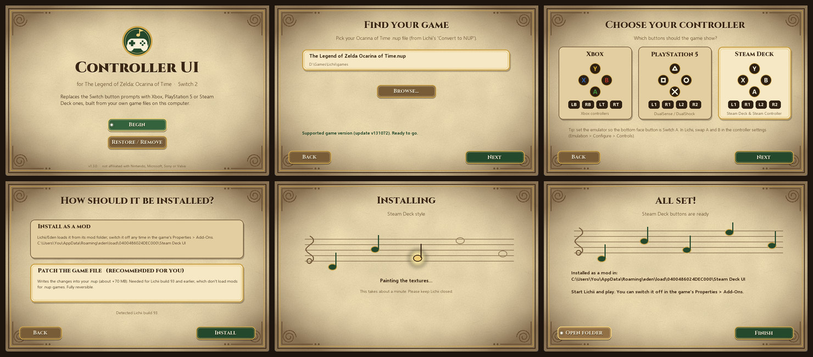
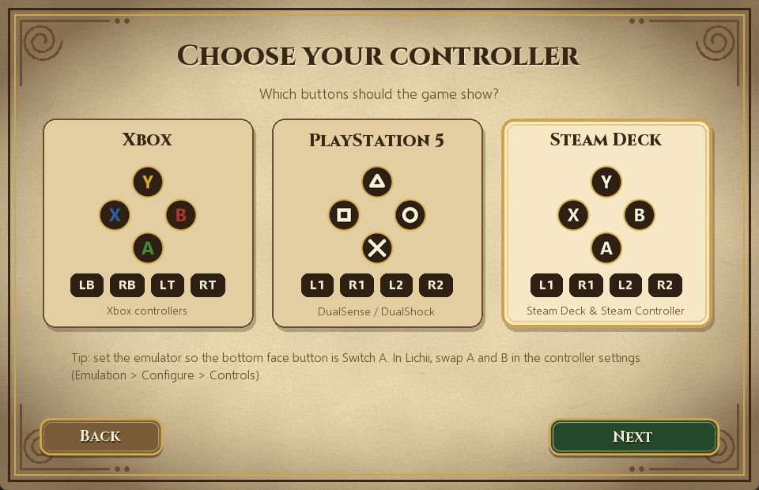
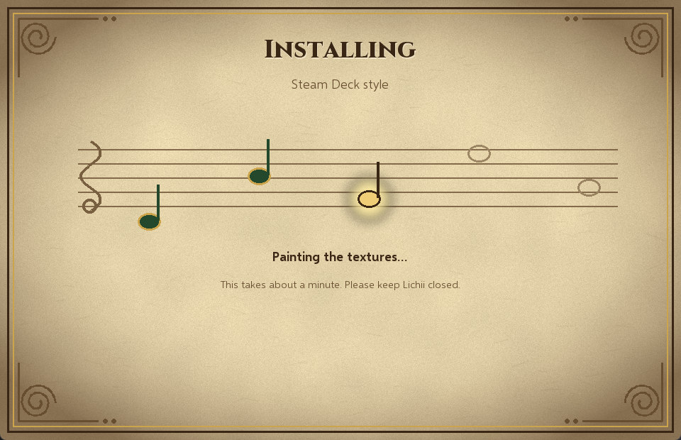

# oot-controller-ui

**Xbox**, **PS5** or **Steam Deck** button prompts for **The Legend of Zelda: Ocarina of Time (Switch 2)**, built on your PC from **your own game files**. This repository contains only code. It ships no game assets.

> [!IMPORTANT]
> **One required setup step: swap A and B in Lichii.** The new icons match your controller only if your **bottom face button presses Switch A** and your **right face button presses Switch B**. Lichii's default does the opposite, so open **Emulation → Configure → Controls** and set **A** to your bottom button (Xbox A / PS ✕ / Steam Deck A) and **B** to your right button (Xbox B / PS ○ / Steam Deck B). X and Y stay as they are. Skip this and the prompts will show the wrong buttons.

## Why a builder instead of edited game files?

Most UI mods are shared as edited copies of the game's own files. This one deliberately isn't:

- **The edited files would still be Nintendo's.** The button prompts live in the game's UI texture bank (about 880 images), its font, its layouts and its size table. Even the controller picture here is Nintendo's drawing with new labels. Uploading edited copies means redistributing the game's copyrighted art, which can be taken down at any time, along with the mod and possibly the uploader's account.
- **So the download only contains the recipe.** The tool reads the files from your own copy of the game, applies the changes on your PC, and writes a normal mod folder. Nothing from the game is ever uploaded or included in a download.
- **Your game file isn't modified.** The mod sits in the emulator's mod folder and can be switched off any time. (The old v1.3.0 installer could patch the game file directly, for Lichii builds that couldn't load mods yet. That's no longer needed.)
- **It also checks your game version.** The tool fingerprints the files before touching anything, so a different game update can't produce a broken mod.

## What it changes

| Where | Switch | Xbox (`--style xbox`, default) | PS5 (`--style ps5`) | Steam Deck (`--style steam`) |
|---|---|---|---|---|
| Face buttons | A · B · X · Y | A · B · **Y** · **X** | **✕ · ○ · △ · □** | A · B · **Y** · **X** |
| Shoulders and triggers | L · R · ZL · ZR | LB · RB · LT · RT | L1 · R1 · L2 · R2 | L1 · R1 · L2 · R2 |
| + / − | + · − | Menu ☰ · View ⧉ | Options ☰ · Create | Menu ☰ · View ⧉ |
| Action ring next to Link | X top, Y left, A right, B bottom | Y top, X left, B right, A bottom | △ top, □ left, ○ right, ✕ bottom | Y top, X left, B right, A bottom |
| Controls screen picture | Pro Controller labels | Xbox labels, Share, guide ring, no C | PS labels, Create, Options, mute bar, PS ring, no C | Xbox-layout labels, View, Menu, "…" button, Steam ring, no C |
| Ocarina note icons | L · R · A · X · Y | LB · RB · A · Y · X | L1 · R1 · ✕ · △ · □ | L1 · R1 · A · Y · X |

The button icons change everywhere they appear: prompts, menus and the ocarina bar. On the Controls screen every button stays where it was, so the pointer lines still land on the right spot. The controller keeps the Pro Controller's shape and only its labels change, so it isn't drawn as a DualSense or a Steam Deck.

The Steam Deck style follows the Deck's own button labels. It also suits other Xbox-layout pads that label their shoulders L1/R1.

## Requirements

- **Your controller mapping.** Every style assumes the bottom face button is Switch A and the right one is Switch B:

  | Switch | Xbox / Steam Deck | PS5 |
  |---|---|---|
  | A | A (bottom) | ✕ (bottom) |
  | B | B (right) | ○ (right) |
  | X | Y (top) | △ (top) |
  | Y | X (left) | □ (left) |

  In yuzu-family emulators (Lichii, Eden…) that usually means **swapping A and B** in the controller settings, because their default maps Switch A to the right-hand button. On a Steam Deck, leave Steam Input on the default gamepad layout and make the same swap in the emulator.
- **Your game, in one of two forms:**
  - **A Lichii `.nup` file.** These need **Lichii build 95 or newer**, the first build that loads mods for `.nup` games ("LayeredFS mods now apply to NUP titles"). On build 93 or older, update Lichii, or use the legacy [v1.3.0 installer](https://github.com/PremiumPirate/oot-controller-ui/releases/tag/v1.3.0), which can patch the `.nup` instead.
  - **An NSP, XCI or installed copy.** First make an extracted copy for the tool to read: right-click the game in Lichii (or Eden), choose **Dump RomFS**, then pick **Full**, not Skeleton. That writes `<user folder>/dump/0400486024DEC000/romfs`, which the installer finds automatically. Mods load for these copies on any Lichii build.
- **Supported game version.** The tool checks the files' SHA-256 hashes and refuses to run on anything else. Currently supported: **update v131072**. The installer checks this for you; on the command line, run `check`.

## Easiest: the installer



Download the installer for your platform from the **[Releases](https://github.com/PremiumPirate/oot-controller-ui/releases/latest)** page and run it. Python isn't needed.

| Platform | File | How to run |
|---|---|---|
| Windows 10/11 (x64) | `…-windows-x64.zip` | Unzip and double-click `OoT-Controller-UI-Installer.exe`. If SmartScreen warns about an unknown publisher, click *More info → Run anyway*. |
| Steam Deck / Linux (x64) | `…-linux-x64-steamdeck.tar.gz` | In Desktop Mode, extract it, then double-click `OoT-Controller-UI-Installer`. If it doesn't start, right-click it, open *Properties → Permissions* and tick *Is executable*. |
| macOS (Apple Silicon) | `…-macos-arm64.zip` | Unzip, then right-click the app and choose *Open*, then *Open* again. The app isn't notarised, so a plain double-click is blocked the first time. |

> **Testing status:** the Windows installer is fully tested. The Steam Deck and Mac installers are new and are being tested on real hardware over the next few days. If you hit a problem on either, please [open an issue](https://github.com/PremiumPirate/oot-controller-ui/issues).

The installer walks you through four steps:

1. **Find your game.** It looks for your `.nup` using Lichii's own settings, and for RomFS dumps in Lichii's `dump` folder. You can also choose either yourself. Then it checks the game version.
2. **Choose a style:** Xbox, PlayStation 5 or Steam Deck.
3. **Check where it goes.** It installs as a mod in Lichii's mod folder, which it finds automatically. If it can't find it (for example, a portable Lichii), use **Choose folder…**. It also reads Lichii's log and warns you if your build is too old to load mods for `.nup` games.
4. **Install.** Takes about a minute. Your game file isn't changed.

<p>
  
  
</p>

**Restore / Remove** deletes the mod. It can also restore a game file patched by the old v1.3.0 installer. Mouse, keyboard and Steam Deck controls all work: the d-pad moves, A selects and B goes back, using Steam's default Desktop controls.

## Command line

You need **Python 3.10+** and the packages in `requirements.txt`.

```bash
pip install -r requirements.txt
```

The installer is also available from the command line: `python -m oot_controller_ui gui`.

```bash
# 1. is your version supported?
python -m oot_controller_ui check --nup "path/to/Ocarina of Time.nup"

# 2. build a mod folder (Lichii build 95+, or any emulator that applies LayeredFS mods)
python -m oot_controller_ui build --nup "path/to/Ocarina of Time.nup" --out "Xbox UI"
python -m oot_controller_ui build --nup "path/to/Ocarina of Time.nup" --out "PS5 UI" --style ps5
python -m oot_controller_ui build --nup "path/to/Ocarina of Time.nup" --out "Steam Deck UI" --style steam

# legacy: patch the .nup directly, for Lichii build 93 and older (which don't apply mods to .nup games)
python -m oot_controller_ui patch-nup --nup "path/to/Ocarina of Time.nup"        # add --style ps5 or --style steam
python -m oot_controller_ui undo      --nup "path/to/Ocarina of Time.nup"
```

Each command takes either a `.nup` file (`--nup`) or an extracted game folder (`--romfs`), such as Lichii's **Dump RomFS** output for NSP/XCI copies (`…/dump/0400486024DEC000/romfs`) or **Extract NUP**.

**Installing the mod folder.** Copy the `Xbox UI`, `PS5 UI` or `Steam Deck UI` folder (the one that contains `romfs/`) into the emulator's mod folder for title `0400486024DEC000`. For Lichii and Eden that's `<user dir>/load/0400486024DEC000/<folder>/`. Then switch it on or off under the game's **Properties → Add-Ons**. Enable only one UI style at a time, because they replace the same files.

**Patching the `.nup` (legacy).** Only needed on Lichii build 93 and older.
- **What it does:** the new files are appended to the end of the `.nup` (about +70 MB), and its file table is pointed at them.
- **Undo:** before changing anything, it saves the original header and table to `<game>.nup.undo`. `undo` uses that file to restore the original byte for byte, and running `patch-nup` again re-patches from the original. That's also how you switch between styles.
- **Before you run it:** close Lichii, and keep your own backup anyway.

**Fonts.** By default, letters such as LB and R2 are drawn with the bundled **Selawik** font, Microsoft's open-source stand-in for Segoe UI. On Windows, `--fonts segoe` uses your installed Segoe UI instead. The result looks nearly identical.

## Please don't share the output

The files this tool writes are Nintendo's game files with edits, so don't upload them anywhere. That covers the mod folder and the patched `.nup`. Share this tool instead, and let people build from their own game.

## How it works

- **Button font.** `Font2/Scalable/External` is a Switch 2 BFTTF font (an XOR-wrapped OpenType file). The private-use glyphs E040–E04C are swapped or redrawn.
- **Texture bank.** `UI/Layout2Archive/Common…bntx` holds the textures. They use Switch 2 block-linear tiling (Tegra GOBs with address bits 5 and 6 swapped), stored as BC4 or ASTC 4×4. The tool repaints the ring letters, the controller picture and the ocarina icons. For Xbox, the X/Y letters are simply swapped.
- **Action ring.** The `DoCommand_00` layout in `Common…blarc` is moved into the bottom/right diamond. The archive stores 4 copies of it, and all four are patched.
- **Size table.** The game's resource size table gets a larger entry for the font.
- **`.nup` format.** It's read using the format described in Lichii's `nup_container.cpp`.

## Built with Claude Code

This project was built with [Claude Code](https://claude.com/claude-code) (Anthropic). Want another controller style, a different game version, or something new? Start with [CLAUDE.md](CLAUDE.md). It explains the code, the safety rules and every file-format detail that took digging to find, so you (or your own Claude Code) can build on it instead of starting from scratch. Pull requests welcome!

## Credits

See [CREDITS.md](CREDITS.md). Code is MIT-licensed ([LICENSE](LICENSE)). The bundled Selawik fonts are under the SIL Open Font License ([oot_controller_ui/fonts/OFL.txt](oot_controller_ui/fonts/OFL.txt)).

*Not affiliated with Nintendo, Microsoft, Sony or Valve. "Xbox", "PlayStation", "PS5" and "Steam Deck" are used only to describe button layouts. No Xbox, PlayStation or Steam logo is drawn.*
